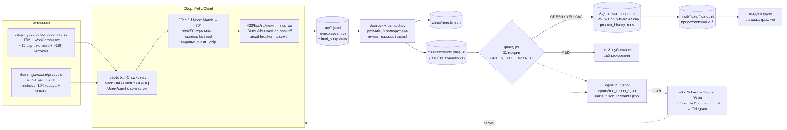

# Отчёт по итоговому проекту

**Исследовательский вопрос:** Как соотносятся уровень цен и структура ассортимента двух учебных
интернет-магазинов - `scrapingcourse.com` (HTML) и `DummyJSON` (REST API) - в сопоставимых
товарных группах, и связаны ли цена и скидка с рейтингом товара и оценками в отзывах?

Вопрос проверяемый (сравнение медиан цен по группам, ранговые корреляции) и требует объединения
источников: в HTML нет рейтингов и отзывов, в API - нет ассортимента одежды того же магазина;
сравнение возможно только после приведения обоих каталогов к единым товарным группам.

**Конфигурация:** B - гибридная (код собирает и обрабатывает, n8n оркестрирует расписание, проверки и оповещения).

---

## 1. Источники и их различия (ось 1 - выбор источников)

Полные паспорта - [`docs/source_passports.md`](docs/source_passports.md).

| | HTML: `scrapingcourse.com/ecommerce` | API: `dummyjson.com/products` |
|---|---|---|
| Тип | статический каталог WooCommerce | REST API, JSON |
| Точка входа | `/ecommerce/` | `/products?limit=50&skip=N&select=…` |
| Пагинация | `a.next.page-numbers` → `/page/N/` | `limit`/`skip` до `total` |
| Объём | ≈ 188 товаров (≈ 12 стр.) + карточки | 194 товара, ≈ 582 отзыва |
| Ключ | slug товара | `id` |
| ПДн | нет | `reviewerName`, `reviewerEmail` - удаляются при сборе |

| Признак | HTML | API |
|---|---|---|
| Цена (USD) | есть | есть |
| Скидка | только у товаров на распродаже (`del`/`ins`) | `discountPercentage` у всех |
| Наличие | `instock`/`outofstock`, текст `p.stock` | `stock`, `availabilityStatus` |
| Категории | иерархия (Men › Tops › Hoodies) | 24 плоских slug |
| Рейтинг, отзывы | нет | есть |
| Бренд | нет | есть |

**Связь источников - сопоставление по единым товарным группам** (`product_groups`: tops, bottoms,
outerwear, bags, watches, fitness, shoes, dresses, other). HTML-товар получает группу по категориям
карточки (ключевые слова, порядок правил важен; запасной вариант - название), API-товар - по slug
категории (`config.yaml → linkage`). Вторая связь - отзывы → товары (N:1, внешний ключ).

**Если один источник недоступен:** изоляция отказа - второй источник собирается и публикуется; чистый слой
для отказавшего строится из последней успешной версии raw; инцидент + оповещение `source_failed`, `exit 1`.
При первом запуске без источника - `min_products_per_source` < порога → RED → `exit 3` (публикации нет).

---

## 2. Выбор инструмента под источник (ось 2)

**HTML → `requests` + `BeautifulSoup`.** Протокол диагностики ([`docs/diagnostics.md`](docs/diagnostics.md),
`python -m src.diagnose`): (1) View Source - 16 карточек `li.product` в исходном HTML; (2) поиск текста -
названия и цены присутствуют без JS; (3) Network/XHR - маркеров клиентского рендеринга нет, пагинация -
обычные ссылки. Вывод: Playwright не нужен; динамические стенды сайта (`/infinite-scrolling`,
`/button-click`) не используются. Найденная альтернатива - WordPress REST (`/wp-json/`), но задание требует HTML.

**Почему не Scrapy:** один домен, ≈ 200 запросов, линейная пагинация. Всё, ради чего берут Scrapy
(автоматические лимиты на домен, повторы, `JOBDIR`, middleware), реализовано компактно в
`src/http_client.py` + `state/checkpoint.json` и прозрачно объясняется на защите.

**API → `requests`.** JSON, простая пагинация, `select` сокращает трафик; общий `PoliteClient` даёт единые
логи, лимиты и обработку ошибок для обоих источников.

| Источник | Инструмент | Обоснование |
|---|---|---|
| scrapingcourse.com | `requests` + `BeautifulSoup` | серверный HTML, JS не нужен (диагностика) |
| DummyJSON | `requests` | REST/JSON, limit/skip, ETag |

### Селекторы HTML (устойчивость)

| Поле | Основной селектор | Запасные |
|---|---|---|
| Карточка | `li.product` | `ul.products > li`, `[data-products='item']` |
| Ссылка / slug | `a.woocommerce-LoopProduct-link` | `a[href*='/product/']` |
| Название | `.product-name` | `.woocommerce-loop-product__title`, `h2`, `h3` |
| Цена | `span.price` (+ `del`/`ins`, диапазон) | `.price`, `[data-testid='product-price']` |
| ID / SKU | `a.add_to_cart_button[data-product_id / data-product_sku]` | класс `post-NNN` |
| Наличие | классы `instock` / `outofstock` на `li` | `p.stock` в карточке |
| Следующая страница | `a.next.page-numbers` | `a.next`, `a[rel=next]` |
| Категории (карточка) | `.product_meta .posted_in a` | `.posted_in a`, `a[rel=tag]` |

Классы WooCommerce - часть темы и стабильны; цены разбираются по структуре (`del`/`ins`/
`.woocommerce-Price-amount`), а не по позиции. Каждое срабатывание запасного селектора и каждый
«промах» пишутся в лог (`selector_fallback`) - ранний сигнал смены вёрстки. Парсеры покрыты тестами на
фикстурах и на реальных снимках HTML из `raw/html_snapshots/`.

---

## 3. Архитектура пайплайна



| Шаг | Модуль | Результат |
|---|---|---|
| Сбор | `collect_html.py`, `collect_api.py` через `http_client.PoliteClient` | `raw/<поток>/<дата>.jsonl` (только дозапись), `raw/html_snapshots/` |
| Очистка, контракт, связь | `clean.py`, `contract.py` | `clean/products.parquet`, `clean/reviews.parquet`, `clean/rejects.jsonl`, `clean/cleaning_protocol.json` |
| Качество | `quality.py` | `reports/quality_<run>.json`, вердикт GREEN/YELLOW/RED |
| Хранилище | `storage.py`, `db/schema.sql` | `db/warehouse.db`: UPSERT, история, журнал прогонов |
| Mart | представления `v_*` | `mart/*.csv`, `mart/*.parquet` (только при не-RED) |
| Наблюдаемость | `observability.py`, `quality.evaluate_alerts` | `logs/run_<id>.jsonl`, `reports/run_report_<id>.json`, `alerts_<id>.json`, `incidents.jsonl` |
| Оркестрация | n8n | расписание, запуск, IF, Telegram |

---

## 4. Модель данных (ось 3)

**Бизнес-ключи.** `products.business_key = "<источник>:<id>"` (`scrapingcourse:abominable-hoodie`,
`dummyjson:17`) - стабилен между прогонами, не зависит от позиции на странице и цены. Суррогатный
`AUTOINCREMENT` отвергнут: при повторной загрузке он даёт дубли. Отзыв: `review_key =
"<product_key>:<hash(rating, comment, date)>"` - у отзывов DummyJSON нет собственного id.

| Таблица | Назначение | Ключевые ограничения |
|---|---|---|
| `products` | товары обоих источников | PK `business_key`, `UNIQUE(source, source_id)`, `CHECK` цены (0;100000], скидки 0–100, рейтинга 0–5, `in_stock ∈ {0,1}`, `regular_price ≥ price`, `json_valid(extra_json)`; FK `product_group` |
| `reviews` | отзывы (2-я сущность) | PK `review_key`, FK `product_key → products`, `CHECK rating 1–5` |
| `product_groups` | справочник связи источников | PK `product_group` |
| `product_history` | история цены/скидки/наличия (SCD2) | заполняется триггерами при INSERT и при реальном изменении |
| `runs` | журнал прогонов | сравнение объёма с предыдущим прогоном |

Индексы: `products(source)`, `products(product_group, source)`, `products(price_usd)`,
`reviews(product_key)`, `reviews(rating)`, `product_history(business_key, valid_to)`.
Служебные поля: `source`, `collected_at`, `first_seen_at`, `updated_at`, `parser_version`, `last_run_id`, `content_hash`.

**Что в JSON (`extra_json`, аналог JSONB):** разнородные атрибуты, по которым не фильтруем на уровне
БД: теги, атрибуты вариаций (размеры/цвета), число вариаций, статус наличия источника, даты `meta`,
ссылка на картинку. Отзывы - отдельная таблица, т.к. это самостоятельная сущность с собственным ключом
и аналитикой.

**Идемпотентная загрузка (UPSERT):**

```sql
INSERT INTO products (...) VALUES (...)
ON CONFLICT(business_key) DO UPDATE SET ... , updated_at = excluded.updated_at
WHERE products.content_hash <> excluded.content_hash;   -- нет изменений -> строку не трогаем
```

`content_hash` считается от всех значимых полей (кроме времени сбора). Перед загрузкой строки
классифицируются: `inserted / updated / unchanged` - это и есть доказательство идемпотентности в отчёте.
Вся загрузка - одна транзакция.

---

## 5. Границы качества (ось 4)

**Обязательные поля** (контракт `CleanProduct`): `business_key`, `source`, `source_id`, `title`,
`product_group`, `price_usd`, `in_stock`, `collected_at`, `parser_version`, `content_hash`;
`CleanReview`: `review_key`, `product_key`, `rating`, `comment`, `review_date`.

**Собственные валидаторы (8):** `normalize_title`, `price_finite_2dp`, `check_price_consistency`
(регулярная цена ≥ текущей и скидка согласована с ценами), `check_stock_consistency` (`stock_qty = 0`
несовместим с `in_stock`), `collected_not_in_future`, `group_known`, `comment_without_pii`,
`review_date_iso`.

**Отбракованные записи** пишутся в `clean/rejects.jsonl` с этапом и причиной
(`parse_price`, `contract_product`, `contract_review`, `dedup`); отзывы отбракованного товара не грузятся
(иначе появятся «сироты»). Счётчики шагов - `clean/cleaning_protocol.json`.

**Метрики качества (11) и пороги** (`config.yaml → quality`):

| Метрика | WARN | CRITICAL | Что ловит |
|---|---|---|---|
| `products_count` | < 350 | < 300 | объём чистого слоя (ТЗ: ≥ 300 при двух сущностях) |
| `min_products_per_source` | < 150 | < 100 | «тихий» отказ одного источника |
| `reviews_count` | < 400 | < 300 | объём второй сущности |
| `reject_rate_pct` | > 2 % | > 10 % | поломка парсера / смена формата |
| `duplicate_key_pct` | > 0,5 % | > 2 % | повторы ключа внутри прогона |
| `missing_category_pct` | > 5 % | > 20 % | полнота категорий |
| `html_unmapped_group_pct` | > 15 % | > 40 % | качество связи источников |
| `price_outlier_pct` | > 3 % | > 10 % | выбросы цены (IQR×3 внутри источника) |
| `orphan_reviews_pct` | > 0 | > 0 | ссылочная целостность |
| `group_overlap_count` | < 3 | < 1 | есть ли вообще что сравнивать |
| `missing_api_rating_pct` | > 1 % | > 5 % | полнота рейтинга |

Вердикт: RED при любом CRITICAL - БД и mart не обновляются (`exit 3`), данные остаются в raw/clean для
разбора; YELLOW - публикация с предупреждением; GREEN - норма.

---

## 6. Режим работы (ось 5)

**Частота:** ежедневно 06:00 (n8n Schedule Trigger; альтернативы - cron/Планировщик Windows в README).

**Вежливость.** Лимит на домен: HTML 1 с + джиттер 0–0,5 с, API 0,5 с + 0–0,3 с; `Crawl-delay` из
robots.txt повышает паузу; `Disallow` соблюдается; `User-Agent` с контактом.

**Снижение нагрузки (5 механизмов из ТЗ):**

| Механизм | Где |
|---|---|
| Условные запросы `If-None-Match` / `If-Modified-Since` → 304 | все страницы листинга, sitemap, страницы API |
| Инкрементальность по водяному знаку | карточки HTML: отпечаток листинга + `sitemap lastmod` + срок 7 дней; API: `meta.updatedAt` + хэш товара - в raw дописываются только изменения |
| Sitemap | `robots.txt → Sitemap:` / `wp-sitemap.xml`; `lastmod` - водяной знак карточек |
| Кэш при отладке | `--debug-cache` (`.cache/http/`, TTL 1 сутки) |
| gzip | `Accept-Encoding: gzip, deflate`; в отчёте - трафик «по сети» и «после распаковки» |

scrapingcourse.com (за Cloudflare) ETag не отдаёт, поэтому для HTML работает запасной механизм - sha256
страницы (`html_unchanged_content`): страница скачивается, но в raw ничего не дописывается, а карточки
товаров не перезапрашиваются (водяной знак). DummyJSON ETag отдаёт.

**Смена версии парсера** (`project.parser_version`) делает карточки «устаревшими» - они перечитываются при
следующем прогоне. Так исправление 1.1.0 (наличие вариативных товаров по вариациям: WooCommerce помечает
сам товар `outofstock`, хотя вариации в наличии) применилось к уже собранным данным.

**Классификация ошибок и реакция:**

| Ситуация | Реакция |
|---|---|
| 429, 408, 425, 500, 502, 503, 504, таймаут, обрыв | повтор (до `max_retries = 3`); пауза = `Retry-After`, если есть (приоритет), иначе `1·2^n + джиттер` |
| прочие 4xx (404, 403, 400) | без повторов; инцидент; для карточки - пропуск, для листинга - отказ источника |
| N = 5 подряд временных отказов домена | **circuit breaker** → OPEN на 60 с, запросы не отправляются, источник изолируется, оповещение `circuit_open` |
| robots.txt запрещает URL (RFC 9309, `*` и `$`) | не запрашиваем (`robots_disallowed`), кроме URL из явного списка исключений - тогда предупреждение `robots_exception_applied` |

**Падение посередине (возобновляемость).** raw дописывается построчно; `state/checkpoint.json` хранит
обработанные страницы листинга и API, `state/watermark.json` - уже собранные карточки (сохраняется каждые
10 карточек и при Ctrl+C), `state/etags.json` - валидаторы и ссылки «next». Следующий запуск видит
`status = running`, продолжает прерванный прогон (`resumed_from` в отчёте) и не перезапрашивает
сделанное. `--fresh` - начать заново.

**Наблюдаемость.** Каждый запрос → `http_request` (url, статус, попытка, латентность, байты тела и
по сети) в `logs/run_<id>.jsonl`. Отчёт о прогоне: число запросов, распределение кодов, доля ошибок,
повторы, 304, латентность (медиана, p95), трафик, собранные/чистые/отброшенные записи,
inserted/updated/unchanged, длительность.

**Пороги оповещения (7):** `source_failed`, `circuit_open`, `quality_red` (critical);
`http_error_rate` (> 5 % warn, > 20 % critical); `latency_p95_high` (> 3 с); `too_many_retries` (> 20);
`volume_drop_vs_previous` (товаров меньше, чем в прошлом прогоне, > 20 % -   warn, > 50 % - critical;
сравнение по таблице `runs`).

---

## 7. Правомерность (ось 6)

> ⚠️ **robots.txt scrapingcourse.com:** `User-agent: * / Disallow: /ecommerce/*` - собираемый раздел
> формально закрыт. Первая версия этого не заметила: стандартный `urllib.robotparser` (Python 3.10) не
> понимает `*`. Исправлено: собственный разбор по RFC 9309 (`src/robots.py`, тесты) и **одно явное
> исключение** в `config.yaml → http.robots_exceptions` с обоснованием (учебная площадка из списка курса,
> щадящий режим). Применение исключения видно в логе (`robots_exception_applied`) и в отчёте о прогоне;
> без исключения пайплайн источник не собирает. Исключение согласуется с преподавателем.

Чек-лист из 12 пунктов - [`docs/legal_checklist.md`](docs/legal_checklist.md); паспорт данных -
[`docs/data_card.md`](docs/data_card.md). Кратко: учебные площадки; без авторизации и обхода защиты;
robots.txt и Crawl-delay соблюдаются; ПДн авторов отзывов удаляются при сборе; хранение локально,
raw - 90 дней (`python -m src.retention`), clean/БД - 365 дней; контакт в User-Agent.

---

## 8. No-code компонент

В проекте два workflow n8n (`nocode/`):

**1. `workflow_scraping.json` - сбор обоих источников нодами n8n, без Python.**

Schedule Trigger 06:00 →
- **HTML:** HTTP Request с пагинацией по ссылке «next» (1 запрос/с, ≤ 30 страниц) → HTML Extract (`li.product`) → Split Out → HTML Extract (название, цена, ссылка) → HTTP Request на страницу каждого товара (1 запрос/с) → HTML Extract (категории, SKU, вариации) → Merge;
- **API:** HTTP Request с пагинацией `skip = $pageCount × 50` до поля `total` → Split Out;
- **Обработка:** Code «Нормализация HTML / API» (цена → число, бизнес-ключ, товарная группа, наличие по вариациям, без ПДн) → Merge → Code «Проверка качества» (7 метрик, светофор) → IF (RED?) → Telegram «инцидент» / «сводка»;
- **Выгрузка:** Convert to File → `nocode/output/products_n8n.csv` (≈ 382 строки) и `reviews_n8n.csv` (≈ 582); опционально Google Sheets (обновление по `business_key`).

У HTTP-узлов включён Retry On Fail (3 попытки).

**2. `workflow.json` - оркестрация Python-пайплайна:** Schedule Trigger 06:00 → Execute Command (`python -m src.n8n_entry`) → Code (разбор JSON-сводки) → IF (critical?) → Telegram.

**Что не удалось перенести в no-code:**
- контракт данных с отбраковкой по причине;
- условные запросы (304) и водяные знаки: n8n не хранит состояние между запусками и каждый раз собирает всё заново;
- чтение robots.txt, джиттер и Crawl-delay;
- разная реакция на временные и постоянные ошибки, Retry-After, предохранитель;
- база данных с историей изменений;
- метрики латентности и трафика.

Нормализация и проверка качества в n8n выполнены узлами Code, то есть по сути это код внутри n8n. Поэтому в итоговой архитектуре (конфигурация B) данные собирает и проверяет Python, а n8n отвечает за расписание и оповещения. `workflow_scraping.json` показывает, что сбор можно повторить нодами, и фиксирует, что при этом теряется.

Инструкция по запуску и полная таблица «этап → код / no-code → что не удалось перенести» — [`nocode/notes.md`](nocode/notes.md), скриншоты — `nocode/screenshots/`.

---

## 9. Результаты запусков

> ⚠️ Заполните таблицы цифрами своих прогонов: всё берётся из `reports/run_report_*.json`,
> `reports/quality_*.json`, `reports/idempotency_demo.json` и вывода `analysis.ipynb`.

### 9.1. Первый (полный) прогон

| Метрика | Значение |
|---|---|
| Длительность | 257 c (≈ 4,3 мин) |
| Запросов (HTML / API) | 204 / 5 |
| Коды ответов | 200 - 209 |
| Повторы / доля ошибок | 0 / 0 % |
| Латентность медиана / p95 | 477 / 785 мс |
| Трафик по сети / после распаковки | 3 222 / 25 223 КБ |
| raw: листинг / карточки / API | 188 / 188 / 194 |
| clean: товары (HTML + API) / отзывы | 382 (188 + 194) / 582 |
| Отбраковано | 0 |
| Качество | YELLOW (выбросы цены 6,8 % > 3 %) |

### 9.2. Идемпотентность (`python -m src.demo_idempotency`)

| Прогон | Запросов | 304 | raw дописано | inserted | updated | unchanged | COUNT(*) products | Дубли |
|---|---|---|---|---|---|---|---|---|
| 1 | | | | | | | | 0 |
| 2 | | | 0 | 0 | 0 | | | 0 |
| 3 | | | 0 | 0 | 0 | | | 0 |

### 9.3. Устойчивость (`--simulate-failure api`)
Ожидаемо: 4 запроса к `httpbin.org/status/503` с паузами по `Retry-After`/backoff, инцидент
`transient_exhausted` в `reports/incidents.jsonl`, оповещения `source_failed` (critical) и
`http_error_rate`, HTML-источник отработал (`OK`), `exit code = 1`. Вставьте фрагмент своего отчёта.

### 9.4. Выводы
Три вывода формируются автоматически в разделе 6 `analysis.ipynb` и сохраняются в
`mart/conclusions.txt` (их же показывает `slides.pdf`). Перенесите сюда с подтверждающими таблицами:

1. **Уровень цен в общих группах** - таблица `mart/price_comparison_by_group.csv`, рис. 1.
2. **Структура ассортимента** - рис. 2, `mart/group_comparison.csv`.
3. **Рейтинг, скидка, отзывы** - корреляции Спирмена, рис. 3–4, `mart/price_rating.csv`,
   `mart/review_consistency.csv`.

### 9.5. Ограничения
Синтетические учебные данные; малые выборки в общих группах; сопоставление групп по правилам;
рейтинг только у API; каталоги статичны (динамика цен появится только при изменениях источника);
удалённые товары не помечаются. Подробно - раздел 7 `analysis.ipynb` и `docs/data_card.md`.

---

## 10. Задания повышенной сложности

| Задание | Статус |
|---|---|
| Тесты `pytest` на парсеры (фикстуры + реальные снимки из raw) и контракт; сквозные тесты на mock | ✅ `tests/` |
| История изменений: `product_history` (SCD2 через триггеры), журнал `runs`, рис. 5 в ноутбуке | ✅ (для динамики нужно ≥ 5 прогонов) |
| Оркестрация n8n с повтором узла и оповещением в Telegram | ✅ `nocode/` |
| Docker / дашборд / легальная альтернатива | не делалось |

---

## 11. Заключение

* **Источники:** HTML (`scrapingcourse.com`) + REST API (DummyJSON), связаны через единые товарные группы;
  вторая сущность - отзывы (N:1).
* **Инструменты:** `requests` + `BeautifulSoup` (браузер не нужен - диагностика), общий вежливый клиент.
* **Хранилище:** raw (JSONL, только дозапись) → clean (Parquet + rejects) → SQLite (UPSERT по бизнес-ключу,
  история SCD2) → mart (представления).
* **Качество:** pydantic-контракт с 8 валидаторами, 11 метрик, RED блокирует публикацию.
* **Режим:** 304/sitemap/водяные знаки/gzip, Retry-After, circuit breaker, checkpoint-возобновление,
  7 порогов оповещения, ежедневный запуск из n8n.
* **Правомерность:** учебные площадки, robots.txt, без ПДн, сроки хранения, контакт в User-Agent.
